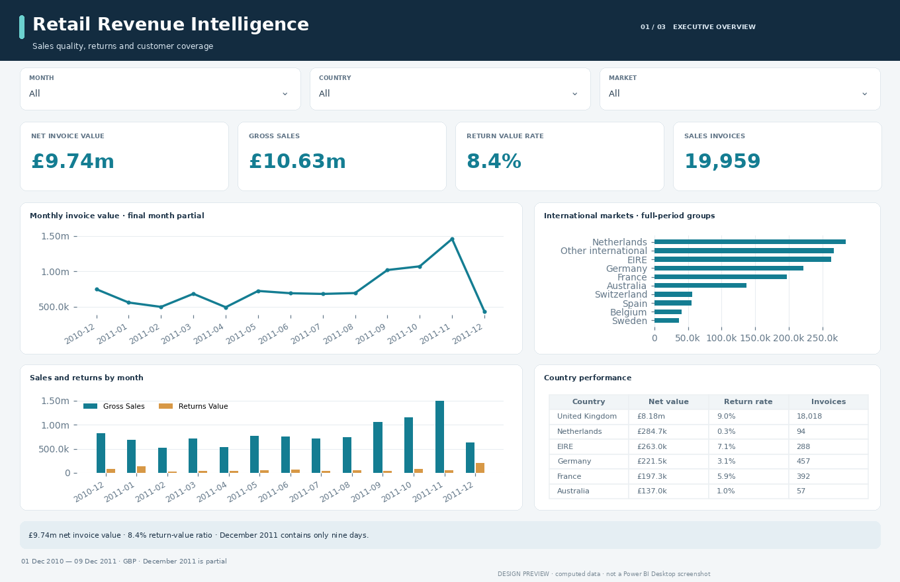
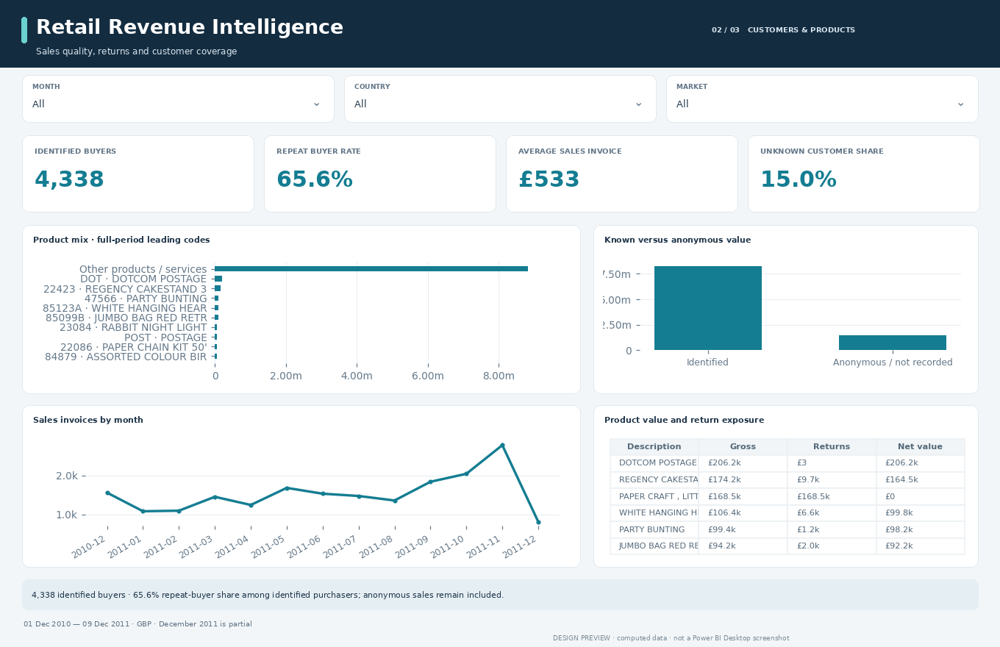
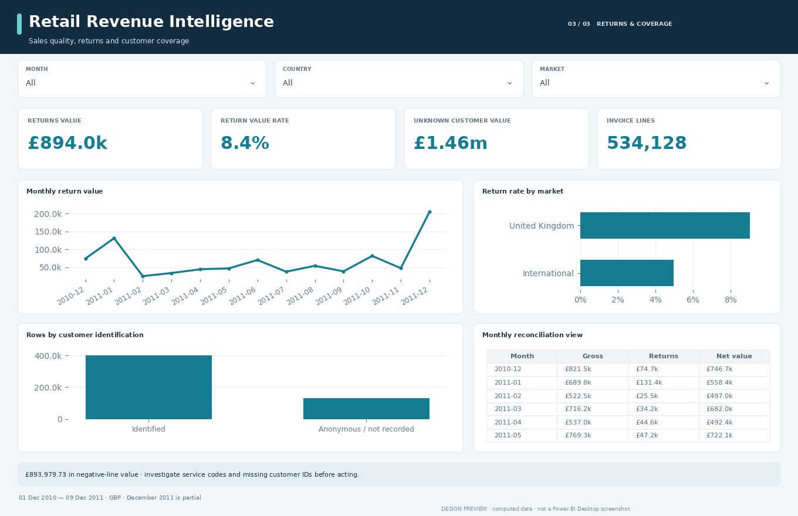

# Retail Revenue Intelligence

Where is invoice value concentrated, and how much do returns and anonymous customers affect interpretation?

An audited UCI data analysis and editable three-page Power BI report for commercial analysts, sales operations and finance partners.

**Delivery status:** data cleaning, analysis and source-format checks complete. Power BI Desktop refresh, DAX/M execution and native rendering await verification. Images are computed design previews, not Desktop screenshots.

## Findings at a glance

| Metric | Audited snapshot |
| :--- | ---: |
| Net invoice value | £9,737,069.01 |
| Gross positive-line value | £10,631,048.74 |
| Return-value ratio | 8.41% |
| Identified purchasing customers | 4,338 |

541,909 original records → **534,128 retained fact rows**. See the [analysis findings](analysis/FINDINGS.md) and [cleaning audit](analysis/cleaning_audit.json) for the complete accounting.

## Report experience

| Page | Interpretation |
| :--- | :--- |
| 01 · Executive overview | £9.74m net invoice value · 8.4% return-value ratio · December 2011 contains only nine days. |
| 02 · Customers & products | 4,338 identified buyers · 65.6% repeat-buyer share among identified purchasers; anonymous sales remain included. |
| 03 · Returns & coverage | £893,979.73 in negative-line value · investigate service codes and missing customer IDs before acting. |

Three report tabs move from an executive overview to segment detail and data quality. Dropdown slicers provide context; category charts expose the relevant record-count denominators through tooltips. Measures recalculate with filters except where an explicit definition documents otherwise. Tables rank by the first metric unless calendar order is required. Native slicer and selection behavior still requires Desktop testing.

| Segment detail | Quality and context |
| :---: | :---: |
|  |  |

## Decisions this analysis supports

**Sales planning.** Review complete months before setting a seasonal planning assumption. November 2011 has £1,456,145.80 net value; December 2011 stops on the ninth.

**Merchandise review.** Separate postage and service codes before building product actions. DOT is postage, so a leading code is not necessarily a leading merchandise item.

**CRM coverage.** Measure the financial exposure of missing identities before a retention campaign. 132,564 retained invoice lines have no customer ID; buyer statistics exclude the Unknown identity.

## Analytical boundaries

Invoice amounts include service codes and lack cost, tax-treatment and accounting adjustments. They establish neither profit nor audited revenue. Exact-line duplicate removal is an assumption; the removed rows remain available. Product focus groups use fixed full-period membership.

Rates use explicit denominators; no targets, profit figures, forecasts or causal effects are invented. [Metric contract](docs/METRIC_CONTRACT.md) · [DAX definitions](docs/MEASURES.md) · [Data dictionary](data_dictionary.csv).

## Project contents

| Location | Purpose |
| :--- | :--- |
| `powerbi/Dashboard.pbip` | Power BI Desktop entry point |
| `powerbi/Dashboard.Report/` | Editable native report pages, visuals and theme |
| `powerbi/Dashboard.SemanticModel/` | Relationships, M imports and DAX measures |
| `data/raw/` | Unmodified source snapshot and provenance hashes |
| `data/clean/` | Cleaned fact and dimension tables |
| `analysis/` | Findings, grouped analysis, cleaning and validation audits |
| `docs/` | Metric contract, report guide and native review checklist |
| `scripts/` | Cleaning, report generation and integrity validation |

[Power BI setup](POWER_BI_SETUP.md) · [Report guide](docs/REPORT_GUIDE.md) · [Validation status](analysis/validation_report.json).

## Source and license

Dataset attribution and source links: [DATA_LICENSE.md](DATA_LICENSE.md). Code: MIT. Dataset: CC BY 4.0. This is a historical analytical portfolio project, not a live operational feed.

Prepared for Saud Alotaibi with automated implementation assistance. Source data, assumptions and verification limits are preserved for review.

## Retail snapshot packaging

The large cleaned fact table is stored losslessly as `data/clean/FactSales.csv.gz`. Run either supplied path-configuration helper before opening Power BI; it also expands the CSV used by the M imports. The decompressed bytes were checked against the complete cleaned table. The cleaning script can also regenerate the CSV from the raw snapshot. No records were sampled or removed for upload.

The unmodified Excel source is transported in three binary parts under `data/raw/` to fit upload limits. Either configuration helper reassembles it and verifies the original SHA-256. The parts were compared byte-for-byte with the complete source; no source content was altered.
